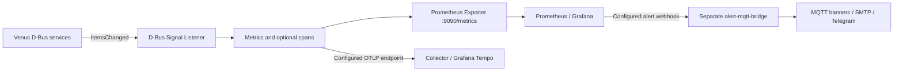
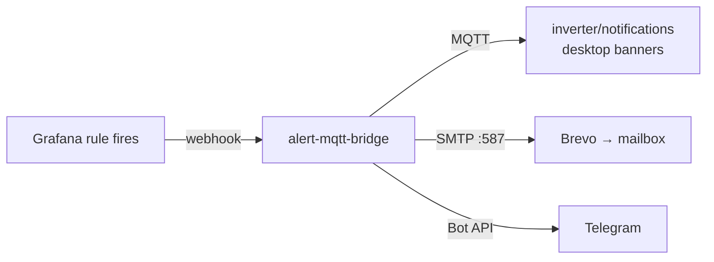

# Venus OS Observability

[](docs/fuzzing.md)

OpenTelemetry/Prometheus observability for Victron Venus OS: D-Bus signal tracing, inverter metrics export, optional application correlation helpers, and a separate Grafana alert relay.

## Python runtime

Native Venus OS packages target **Python 3.12.x**. The audited Raspberry Pi 3
running Venus OS v3.75 reports Python **3.12.13**; the [official Venus OS v3.79 manifest](https://updates.victronenergy.com/feeds/venus/release/sdk/venus-scarthgap-x86_64-arm-cortexa8hf-neon-toolchain-v3.79.target.manifest)
also ships 3.12.13. Local development and CI use `.python-version` / Python
3.12.13. Package metadata accepts 3.12 patch updates and rejects other minor
versions until they have been validated. Use the firmware's system interpreter
and its matching D-Bus/GI libraries on the device; do not replace the OS Python.

<!-- ci-release-process:start -->
## Release process

See the [release strategy](RELEASING.md) for validation, nightly, beta, RC and stable promotion rules, and the [operator runbook](docs/release-workflow.md) for local commands.
<!-- ci-release-process:end -->

## Architecture



## Features

- **D-Bus Signal Tracing**: Observe Victron `ItemsChanged` signals; record spans when tracing is configured
- **Prometheus Metrics**: Export inverter state (SOC, power, grid, battery) as Prometheus metrics
- **Correlation Helpers**: Explicit MQTT/application instrumentation helpers; installing the agent does not instrument other services or propagate context across native D-Bus automatically
- **Grafana Tempo Integration**: Visualize trace timelines in Grafana
- **Native Venus OS Service**: Supports native supervision; offline pip installation requires wheels matching the target Python version and architecture

Explicitly unavailable numeric D-Bus values, including Venus empty arrays, are
exported as `NaN` in both metric backends. They replace the previous reading and
do not discard other items in the same signal. A later valid zero is retained as
zero. Text-only updates do not replace numeric measurements. This handles value
invalidation; it does not independently detect every silent source outage.

## Deployment evidence

The [verification record and acceptance checklist](docs/deployment-evidence.md)
separate historical runtime observations from source tests and current deployment
checks. A release does not establish that its artifact is installed or that every
configured alert channel reaches a recipient.

## Installation

### Option 1: SetupHelper / PackageManager (Recommended)

**Preferred install path on Cerbo GX / Venus OS** — same as `dbus-ev` and `inverter-control`. Requires [SetupHelper](https://github.com/kwindrem/SetupHelper) on the GX.

The easiest way to install is via SetupHelper PackageManager. The `setup` script is PackageManager-compatible and handles service creation, `/data/rc.local` boot persistence, and restarts.

Package files needed at `/data/venus-os-observability`: `version`, `setup`, `gitHubInfo`, `update.sh`, `src/`, `services/`.

1. **Add package via GUI** (GUI v1):
   - Settings → PackageManager → Inactive packages → **new**
   - Package name: `venus-os-observability`
   - GitHub user: `victron-venus`
   - Branch / tag: `latest` (matches `gitHubInfo`)
   - Proceed → Download → Install

2. **Or on the device**:

```sh
/data/venus-os-observability/setup install
/data/venus-os-observability/setup uninstall
```

`gitHubInfo` is `victron-venus:latest`.

`update.sh` (also called by `setup install`):

- Installs into **`/data/venus-os-observability`** (SetupHelper convention).
- Copies daemontools service to `INSTALL_DIR/service/venus-os-observability/` and symlinks `/service/venus-os-observability`.
- Writes an idempotent **`/data/rc.local`** marker block so the symlink is recreated after reboot (`/service` is tmpfs). Venus OS does **not** run `/data/rc/S99*`.
- Migrates `.venv2` from a legacy `/data/opt/venus-os-observability` install when present.
- Removes the dead `/data/rc/S99venus-os-observability.sh` hook if found.

Manual refresh from a checkout on the Mac:

```sh
# stream repo → device, run update.sh (same pattern as dbus-ev deploy.sh)
COPYFILE_DISABLE=1 tar --no-xattrs \
  --exclude='.git' --exclude='.venv' --exclude='__pycache__' \
  --exclude='.pytest_cache' --exclude='.ruff_cache' --exclude='logs' \
  --exclude='*.egg-info' --exclude='build' --exclude='dist' --exclude='wheels' \
  -czf - -C /path/to/venus-os-observability . \
| ssh root@cerbo 'set -e; rm -rf /data/.vos-obs-deploy; mkdir -p /data/.vos-obs-deploy; \
    tar -xz -C /data/.vos-obs-deploy; sh /data/.vos-obs-deploy/update.sh; \
    rm -rf /data/.vos-obs-deploy; svstat /service/venus-os-observability'
```

Runtime prefers `.venv2/bin/python`, then `.venv/bin/python`, with
`PYTHONPATH=/data/venus-os-observability/src` so source updates take effect.
Installation checks imports before stopping the service, preserves supervisor
directories, and never kills processes merely because their working directory
is the package directory. Only `/data/venus-os-observability` is supported.

The boot hook is inserted before a conventional `exit 0` in `/data/rc.local`.
`/service` is volatile; `/data/rc/S99*` is not a supported boot hook.
Logs use `multilog t s25000 n4` under `/var/log`, approximately 125 KB including
the current file, rather than an unbounded file on persistent flash.

#### Offline wheel bootstrap (first installation)

Check `python3 --version` and `uname -m` on the target first. The audited Cerbo
uses Python 3.12 and ARMv7; Raspberry Pi images may differ. Build the wheel bundle
with `scripts/build_wheels.sh` on a matching Linux architecture/Python ABI.
It resolves versions from `pyproject.toml`, requires binary dependency wheels,
and includes a pip wheel. It is not an ARM cross-compiler. If a native wheel is
unavailable, build it in a matching build environment before deployment.

Venus OS provides `dbus-python` and GLib. Preserve access to these native bindings
using `--system-site-packages`; `dbus-next` cannot replace them for this agent.
Do not install replacement bindings over the firmware's Python packages.

Copy and extract the bundle under `/data/venus-os-observability/wheels`, then:

```sh
cd /data/venus-os-observability
python3 -m venv --system-site-packages --without-pip .venv2
# pip can run directly from its wheel, even when ensurepip is absent.
for wheel in wheels/pip-*.whl; do
    PYTHONPATH="$wheel" .venv2/bin/python -m pip install \
        --no-index --find-links=wheels venus-os-observability
done
sh update.sh
svstat /service/venus-os-observability /service/venus-os-observability/log
tail -n 60 /var/log/venus-os-observability/current
wget -qO - http://127.0.0.1:9090/metrics
```

If the image lacks `venv` itself, prepare a compatible offline virtualenv
bootstrap first; the installer does not silently fetch packages from the
internet. Repeat the bootstrap after firmware changes the Python ABI.

Tracing is optional: install the `tempo` extra from a matching offline bundle
and configure `OTEL_EXPORTER_OTLP_ENDPOINT` only when the device has headroom.
Without an endpoint, the sampler drops spans and avoids D-Bus payload serialization;
metrics remain active. D-Bus string subclasses are converted to native strings
before recorded span attributes are validated.

Local plaintext gRPC remains the default. For HTTPS collectors, select
`OTEL_EXPORTER_OTLP_PROTOCOL=http/protobuf` and configure the collector's
OTLP/HTTP endpoint; HTTPS gRPC is rejected because its native TLS backend does
not enforce the required minimum certificate key strengths. See
[OTLP transport and migration](docs/otlp-transport.md) before changing an
existing deployment. No protocol, port or TLS configuration is changed silently.

Metric labels use stable Venus service names. The exporter subscribes to
`NameOwnerChanged` before asynchronous startup discovery, removes superseded
owners and invalidates that service's previously published gauges on loss or
replacement. Fresh measurements restore those gauges; stable counters remain
cumulative. A reconnect of the same well-known service does not create new
per-process metric series. Adding genuinely new service names or item paths can
still create new series; this is not a global registry quota.

Signals received before their sender is resolved are replayed in arrival order
once the Venus service is known. Unresolved input is limited to 256 batches and
4,096 items, with a 10-second monotonic expiry. Overflow removes the oldest
unresolved batches; an oversized single batch is discarded. The fixed-reason
`victron_dbus_unresolved_signals_dropped_total` counter exposes overflow/expiry,
and warnings are limited to one per minute. Known services bypass this queue.
Owner discovery uses asynchronous calls with five-second deadlines; failed
discovery can retry after five seconds, while other unknown-sender refreshes
are limited to once per minute. It does not perform a blocking scan per signal.

The historical IPK Makefile was an OpenWrt/systemd recipe, not a working Venus
OS package. It now fails with an explicit migration message. The `systemd/`
example is for separate Linux hosts only; native GX deployment uses SetupHelper.

Release candidates provide `venus-os-observability-VERSION.tar.gz` and
`SHA256SUMS`. This archive contains the native installer, all runtime modules,
service scripts, example configuration and Python package metadata. CI validates
its contents, executable modes and matching package versions before publication.
Extract its single top-level directory into a staging directory and run its
`update.sh` to update the standard `/data/venus-os-observability` installation.
Device configuration, virtual environments and live supervisor directories are
preserved. Dependency wheels are a separate prerequisite; neither this source
archive nor the Python wheel is an IPK package.

Wheel and source distributions accompany the verified GitHub release assets.
PyPI publication requires a separate explicit promotion of those same verified
distributions, as described in [RELEASING.md](RELEASING.md). A GitHub release alone
does not imply that the same version is available from PyPI.

### Option 2: Docker Compose

For non-GX hosts or a containerized stack (not the preferred Cerbo path):

```yaml
services:
  venus-observability:
    image: ghcr.io/victron-venus/venus-os-observability:latest
    environment:
      - DBUS_SYSTEM_BUS_ADDRESS=unix:path=/run/dbus/system_bus_socket
      - OTEL_EXPORTER_OTLP_ENDPOINT=http://tempo:4317
      - PROMETHEUS_PORT=9090
    volumes:
      - /run/dbus:/run/dbus
    ports:
      - "9090:9090"
    restart: unless-stopped
```

## Metrics Exported

| Metric | Type | Description |
|--------|------|-------------|
| `victron_battery_soc` | Gauge | Battery state of charge % |
| `victron_battery_power` | Gauge | Battery charge/discharge power (W) |
| `victron_pv_power` | Gauge | Total PV production (W) |
| `victron_grid_power` | Gauge | Grid import/export (W) |
| `victron_ac_loads` | Gauge | AC loads consumption (W) |
| `victron_inverter_state` | Gauge | Inverter state machine (0=off,1=on,2=charging,3=inverting) |

## Alert Delivery Setup

Configure Grafana alert rules such as `venus-agent-down`, `venus-dbus-errors` and
`venus-signals-stale`, then route their grouped webhooks to a separately deployed
`alert-mqtt-bridge`. The agent does not create Grafana rules, contact points or
recipient credentials automatically.

| Channel | Path | Installation prerequisite |
|---|---|---|
| MQTT banners | Grafana → `alert-mqtt-bridge` → `inverter/notifications` | Broker access, contact point and dashboard consumer |
| Email | Grafana → `alert-mqtt-bridge` → SMTP relay with STARTTLS | Relay account and verified sender/recipient configuration |
| Telegram | Grafana → `alert-mqtt-bridge` → Bot API | Bot token and an authorized chat |

These paths describe supported integrations, not a current delivery-status
monitor. The installation notes originally recorded successful email and
Telegram delivery on 2026-08-24; repeat firing and resolved delivery checks after
changes. See [evidence and limits](docs/deployment-evidence.md).

> **Secrets rule:** real tokens and passwords never go into this repository.
> README examples keep `<placeholders>`; actual values live in
> a protected deployment secret store or mode-600 environment file outside Git.
> For a local working copy use a `*.local` file — already covered by `.gitignore`.

### Grouped delivery and query failures

The bridge preserves Grafana webhook grouping: one email and one Telegram
message per payload, with individual MQTT banners for independent problems.
`DatasourceError` and `DatasourceNoData` instances from the same source and
status become one notification naming the data source, affected checks, and
query error. They no longer reuse the underlying rules' failure summaries.
Recovery notifications explicitly say `Resolved`; a mixed group still includes
both active and recovered problems.

Notification routing and Prometheus endpoints are deployment-specific. Keep site
configuration and operational evidence outside this public repository. Configure
Grafana grouping, pending periods and reminder intervals for the installation,
and keep query errors separate from application alerts. Do not change an error
state to Normal merely to silence a broken monitoring pipeline.
The bridge does not impose an additional cooldown that could hide a new incident.

### Channel 1: MQTT banners

Source: [`alert-mqtt-bridge/`](alert-mqtt-bridge/). Deploy the relay, configure its
broker connection, and create a Grafana webhook contact point for it. Attach that
contact point to the intended notification policies. Verify both firing and
resolved messages in the dashboard; rules outside those policies are not routed
automatically.

### Channel 2: Telegram

#### 2.1 Create the bot with @BotFather

1. In Telegram, open **@BotFather** (verified badge) and send `/newbot`.
2. Answer two prompts:
   - **name** — display name, anything, e.g. `Alvit Venus Alerts`
   - **username** — must end in `bot`, e.g. `alvit_venus_alerts_bot`
3. BotFather replies with the **token**, format:

   ```
   1234567890:AAHfJ8xQm3k9...your-token-here
   ```

   Keep it secret: anyone with this token controls your bot.

Useful extra commands later: `/mybots` → edit name/description,
`/revoke` → invalidate and reissue a token, `/deletebot`.

#### 2.2 Get your chat id

A bot cannot message you first — start the chat yourself:

1. Open your new bot in Telegram and press **Start** (send any message).
2. Then fetch recent updates (run anywhere with internet):

   ```bash
   curl -s https://api.telegram.org/bot<YOUR_BOT_TOKEN>/getUpdates
   ```

3. Find your id in the response:

   ```json
   {"result":[{"message":{"chat":{"id":987654321,"first_name":"..."}}}]}
   ```

   That `id` number is your **chat id**. Alternative: send any message to
   **@userinfobot** and it replies with your id.

For a **group chat**: add the bot to the group, post one message there, then call
`getUpdates` again — the group's `chat.id` is negative (e.g. `-1001234567890`);
use it as-is.

#### 2.3 Wire the bridge (Synology)

The reference installation uses the bridge for Telegram delivery. Configure
that path explicitly rather than assuming a Grafana-native contact point is active. Append to
`/volume1/docker/venus-alert-bridge/envfile` (chmod 600, outside git):

```
TG_BOT_TOKEN=<your-bot-token>
TG_CHAT_ID=<your-chat-id>
```

(`TG_CHAT_ID` accepts a comma-separated list for group chats.) Then rebuild
and recreate the container per **Channel 3 → 3.2**. Each webhook group goes to
MQTT banners plus one email/Telegram digest,
including firing and recovery states.

#### 2.5 Verify end-to-end

First use a Grafana test notification to check the configured route without
interrupting monitoring. Confirm both the recipient and dashboard receive it;
this tests delivery, not the agent-down rule. To test that rule during an agreed
maintenance window, temporarily stop the agent on the intended Venus host:
`venus-agent-down` should fire after its configured `for` window. Resume the agent
and verify the resolved message even if delivery fails:

```bash
ssh root@cerbo 'svc -d /service/venus-os-observability'   # pause
# wait ~2-3 min: Telegram message + dashboard banner appear
ssh root@cerbo 'svc -u /service/venus-os-observability'   # resume -> resolved message
```

### Channel 3: Email via alert-mqtt-bridge + external SMTP relay

In the reference installation's 2026-08-24 notes, outbound port 25 was blocked,
a usable PTR record was unavailable, and its Grafana-native email contact point
produced no SMTP attempt or provider event. That installation used the bridge
with an external STARTTLS relay. These are historical site observations, not a
claim about every ISP, Grafana version or current deployment. The configured path is:



#### 3.1 Provider setup (Brevo, one-time)

1. Sign up at <https://www.brevo.com> (free tier: 300 emails/day, no card).
2. **Senders & Domains → Senders → Add sender**: use your real mailbox
   (e.g. a gmail address) and click the confirmation link Brevo emails you.
   This skips domain/DKIM work entirely; trade-off: mail goes out "via brevo"
   and may land in spam until you mark it as not-spam once.
   (Better deliverability later: verify `alvit.2560801.xyz` under Domains,
   copy the DKIM records into your DNS zone, send from that domain.)
3. **SMTP & API → SMTP → Create new key**: note LOGIN and SECRET KEY.

#### 3.2 Bridge configuration (Synology)

Secrets live in `/volume1/docker/venus-alert-bridge/envfile` (chmod 600,
outside any git repo):

```
SMTP_HOST=smtp-relay.brevo.com
SMTP_PORT=587
SMTP_USER=<login>@smtp-brevo.com
SMTP_PASSWORD=<secret-key>
SMTP_FROM=<verified-sender@example.com>
SMTP_TO=<recipient@example.com>
```

`SMTP_HOST` or `SMTP_TO` empty ⇒ email channel disabled, MQTT-only.

Email requires STARTTLS and a certificate valid for `SMTP_HOST`, signed by a
trusted CA. The bridge verifies the server before sending SMTP credentials or
the alert. A missing STARTTLS extension, untrusted certificate or hostname
mismatch fails this delivery attempt and is logged; it never falls back to
plaintext SMTP. If using a private CA, mount its CA bundle and set
`SSL_CERT_FILE` to that file inside the container. Existing relays with invalid
certificates must be corrected or given their proper CA trust before upgrading.

Deploy/update the container:

```bash
cd /volume1/docker/venus-alert-bridge
sudo docker build -t venus-alert-bridge:latest .
sudo docker rename venus-alert-bridge venus-alert-bridge-old && sudo docker stop venus-alert-bridge-old
sudo docker run -d --name venus-alert-bridge --restart unless-stopped \
  --network inverter-monitoring_monitoring --network-alias venus-alert-bridge \
  -e MQTT_HOST=192.168.160.150 --env-file envfile venus-alert-bridge:latest
```

No Email contact point is needed in Grafana. The default policy and the
site-specific nested policies send grouped webhooks to **MQTT bridge**.
The site policy and rollout instructions are documented above.

#### 3.3 Verify

1. Check a test notification first; test actual firing and recovery during a
   maintenance window as described in channel 2.5.
2. Bridge log shows `Email sent: <alertname>`; check inbox AND spam folder.
3. Brevo console → Transactional → Statistics shows per-message events
   (delivered / blocked / rejected) — fastest place to diagnose rejects.
4. Optional scoring: send a test via the same relay to the address shown at
   <https://www.mail-tester.com>; aim for ≥9/10.

## Development

```bash
# Install deps
pip install -e ".[dev]"

# Run tests
pytest

# Lint
ruff check src tests
mypy src/venus_observability
```

## License

MIT

---

## Related Projects

| Project | Scope | When to Use |
|---------|-------|-------------|
| [mqtt-observability-opentelemetry](https://github.com/4alvit/mqtt-observability-opentelemetry) | **Generic** — Works with ANY MQTT broker. No Venus OS dependency. | Generic MQTT/IoT observability, any broker, any device types |
| **venus-os-observability** (this) | **Venus OS specific** — Depends on D-Bus, Victron protocols. | Victron Venus OS only: D-Bus event tracing, inverter metrics, Cerbo GX integration |

**Choose mqtt-observability-opentelemetry if:** You need MQTT observability for any IoT system (industrial, home automation, custom devices).

**Choose this repo if:** You are running Victron Venus OS (Cerbo GX, Raspberry Pi with Venus OS) and need D-Bus integration, inverter-specific metrics, and Venus OS native deployment.

## Contributing and security

See [CONTRIBUTING.md](CONTRIBUTING.md) for reports, development checks and pull requests,
[SECURITY.md](SECURITY.md) for private vulnerability reporting and deployment trust boundaries,
and the [OpenSSF evidence index](docs/openssf-evidence.md) for assessment references and remaining verification.

The alert relay verifies exact certificate key sizes for SMTP STARTTLS and Telegram HTTPS.
See [alert relay TLS policy](docs/alert-relay-tls.md) for trusted CA, proxy and migration requirements.

## Release-candidate fuzzing

The real correlation-context and header propagation functions receive synthetic identifiers, including Unicode and punctuation. Header extraction must preserve explicitly supplied IDs and context tokens must restore prior state. No trace exporter, D-Bus subscription or network connection starts.

[RC-only fuzzing policy, local reproduction and failure handling](docs/fuzzing.md).
